# دستیار خرید حضوری ترب (Torob In-Person Shopping Agent)

دستیار مکالمه‌ای فارسی/RTL که چهار کار را پشت سر هم انجام می‌دهد:

1. **کشف نیاز** با پرسش‌های هدفمند (نوع محصول، برند، بودجه)
2. **انتخاب محصول** از کاتالوگ واقعی دیتاست (۲۲۵٬۹۰۳ محصول)
3. **یافتن فروشگاه‌های حضوری تهران** که واقعاً برای آن محصول آفر دارند (اتصال واقعی `offers ↔ shops ↔ products`)
4. **درخواست تأیید قیمت/موجودی/ساعت کاری** با برچسب صریح «نمایشی» یا «کانال واقعی» — و پیشنهاد جایگزین وقتی شرطی برآورده نمی‌شود

> **اصل حاکم بر کل پروژه:** داده‌ای که تأیید نشده، تأییدشده نمایش داده نمی‌شود.
> قیمت دیتاست ≠ قیمت زنده. آفر ≠ موجودی. نام فروشگاه در دیتاست ≠ هویت تأییدشده.

---

## وضعیت واقعی اجرا (آنچه تست شده است)

| مورد | وضعیت | جزئیات |
|---|---|---|
| import دیتاست | ✅ اجرا شد | ۶٬۴۷۶ فروشگاه / ۲۲۵٬۹۰۳ محصول / ۳۳۱٬۵۰۶ آفر در **۴۳–۵۵ ثانیه** (دیتابیس ۵۰۷ مگابایت) |
| صحت FK | ✅ تأیید شد | ۰ آفر یتیم؛ ۳٬۷۹۲ فروشگاه دارای آفر |
| تست‌های واحد و API | ✅ ۱۴۴ تست پاس | `pytest` روی نمونه‌ای از داده واقعی (بدون دیتاست: ۶۵ پاس + ۷۹ skip تمیز) |
| تست دودی سرتاسری | ✅ پاس | `scripts/smoke_test.py` — کل مسیر ۴ مرحله‌ای |
| build فرانت‌اند | ✅ بدون خطا | TypeScript + Next.js 14 |
| اجرای مرورگر | ✅ بررسی شد | ۵ صفحه، بدون خطای کنسول (اسکرین‌شات‌ها در `docs/screenshots/`) |
| مهاجرت Alembic | ✅ رفت‌وبرگشت | `upgrade head` و `downgrade base` |
| Docker | ⚠️ ساخته نشد | Docker روی ماشین توسعه نصب نیست؛ Dockerfileها نوشته و بازبینی شده‌اند اما `docker build` اجرا نشده |

---

## شروع سریع (بدون Docker)

```bash
git clone <repo> && cd torob_agent

# ۱) دیتاست را در ./data بگذارید
#    data/shops.csv  data/products.csv  data/offers.csv

# ۲) وابستگی‌ها
make install                       # یا: pip install -r backend/requirements.txt && (cd frontend && npm ci)

# ۳) متغیرهای محیطی
cp .env.example .env

# ۴) ساخت اسکیمای دیتابیس + import داده (~۱ دقیقه)
make migrate
make import

# ۵) اجرا (حالت توسعه)
make dev-backend                   # http://localhost:8000/docs
make dev-frontend                  # http://localhost:3000

# یا حالت production (همان مسیر Docker — تست شده):
make build && make start
```

### با Docker

```bash
cp .env.example .env
# فایل‌های CSV را در ./data بگذارید
docker compose up --build -d
docker compose run --rm backend python scripts/import_csv.py
open http://localhost:3000
```

---

## ساختار پروژه

```
torob_agent/
├── backend/
│   ├── app/
│   │   ├── core/                 # منطق خالص و تست‌پذیر
│   │   │   ├── text.py           #  نرمال‌سازی فارسی، تشخیص بودجه
│   │   │   ├── hours.py          #  تحلیل weekly_hours («الان باز است؟»)
│   │   │   └── payment.py        #  تفسیر payment_options با سطح اطمینان
│   │   ├── db/                   #  مدل‌ها، اتصال، init
│   │   ├── services/
│   │   │   ├── search.py         #  جست‌وجوی محصول + پیشنهاد دسته
│   │   │   ├── stores.py         #  یافتن/رتبه‌بندی فروشگاه با Haversine
│   │   │   └── verification.py   #  تأیید Demo/واقعی با برچسب صریح
│   │   ├── agent/                # ★ ایجنت
│   │   │   ├── loop.py           #  حلقهٔ تصمیم→ابزار→مشاهده (مدل یا قطعی)
│   │   │   ├── llm.py            #  آداپتور OpenAI/OpenRouter/Groq/Ollama/Anthropic
│   │   │   ├── planner.py        #  برنامه‌ریز قطعی (حالت بدون کلید)
│   │   │   ├── tools.py          #  ۹ ابزار با JSON Schema + رجیستری
│   │   │   ├── shopping.py       #  نقشهٔ خرید حضوری + چک‌لیست بازرسی
│   │   │   └── prompts.py        #  پرامپت سیستم با قواعد ضد-ساختگی
│   │   ├── api/routes.py         #  مسیرهای FastAPI
│   │   ├── schemas/              #  قرارداد Pydantic
│   │   └── main.py
│   ├── scripts/
│   │   ├── import_csv.py         #  import جریانی CSV → DB
│   │   ├── precompute_stats.py   #  پیش‌محاسبه آمار آفرها
│   │   └── smoke_test.py         #  تست سرتاسری روی داده کامل
│   ├── tests/                    #  ۱۳۲ تست
│   ├── alembic/                  #  مهاجرت‌ها
│   └── Dockerfile
├── frontend/                     # Next.js 14 App Router، RTL، mobile-first
│   ├── app/
│   │   ├── page.tsx              #  خانه + بنر شفافیت داده
│   │   ├── discover/             #  گفت‌وگو با ایجنت + ردیابی ابزار
│   │   ├── stores/               #  فروشگاه‌ها، فیلتر، مقایسه
│   │   ├── product/[id]/         #  جزئیات محصول و مشخصات
│   │   └── tracking/             #  پیگیری وضعیت تأیید
│   ├── components/
│   │   ├── provenance-badge.tsx  #  نشان‌های «تأییدنشده / نامشخص / نمایشی»
│   │   ├── tool-trace.tsx        #  ★ ردیابی ابزار: ایجنت چه کرد
│   │   ├── purchase-plan.tsx     #  ★ نقشهٔ خرید حضوری گام‌به‌گام
│   │   ├── theme-toggle.tsx      #  ★ روشن/تاریک/سیستم
│   │   ├── site-header.tsx       #  ★ ناوبری + سوییچ تم
│   │   ├── product-card.tsx
│   │   ├── store-card.tsx
│   │   └── product-image.tsx
│   └── Dockerfile
├── docs/
│   ├── architecture.md           #  تصمیم‌های معماری و چرایی‌شان
│   ├── agent.md                  #  ★ معماری ایجنت: مدل، ابزارها، حلقه
│   ├── dataset.md                #  پروفایل کامل داده واقعی
│   ├── demo-script.md            #  سناریوی دموی ۵ دقیقه‌ای
│   ├── deployment.md             #  استقرار
│   ├── api.md                    #  مرجع API
│   └── known-issues.md           #  گزارش خطاها و محدودیت‌های شناخته‌شده
├── docker-compose.yml
├── Makefile
└── .env.example
```

---

## نمای محصول

همه اسکرین‌شات‌ها از اجرای واقعی روی دیتاست گرفته شده‌اند (۳۹۰×۸۴۴، RTL).

| صفحه | روشن | تاریک |
|---|---|---|
| خانه + شناسنامهٔ داده | 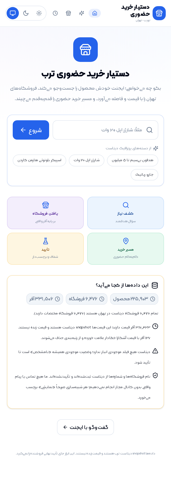 | 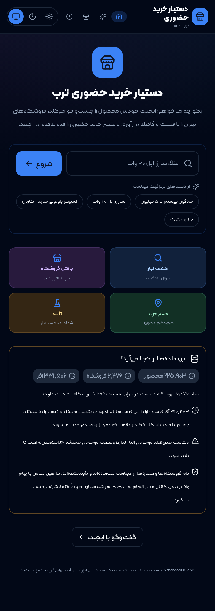 |
| اجازهٔ موقعیت (پرسش صریح) | 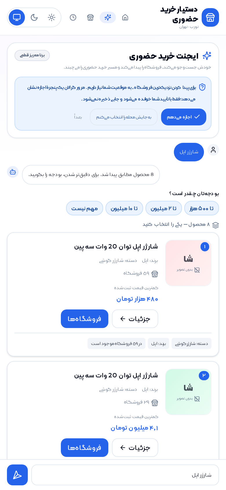 | 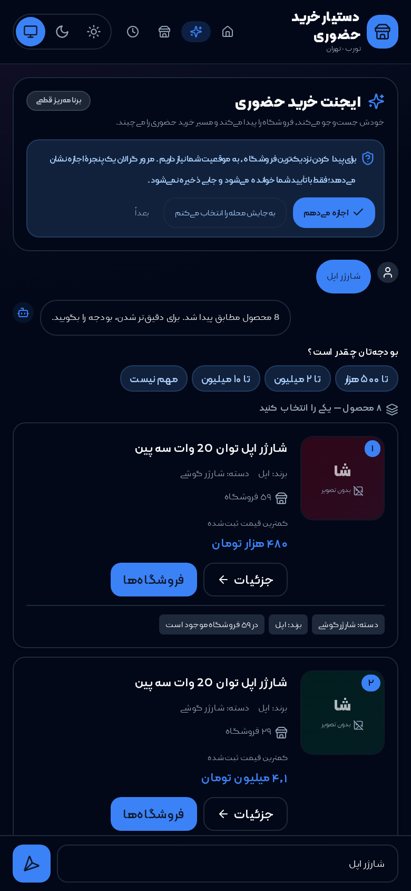 |
| پیشنهاد محصول | 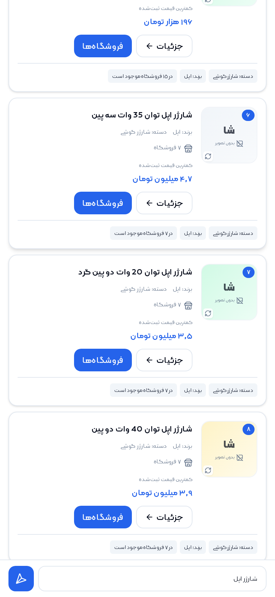 | 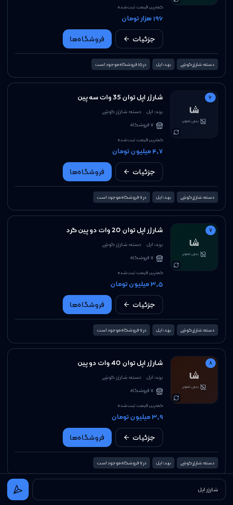 |
| نقشهٔ خرید + فروشگاه‌ها |  | 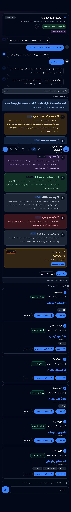 |
| مسیریابی چندسرویسی | 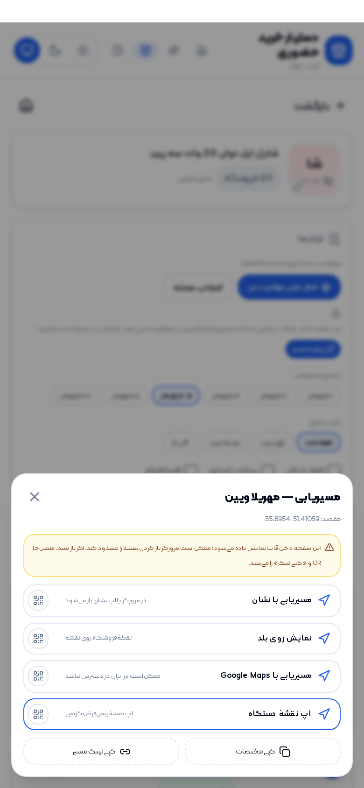 | 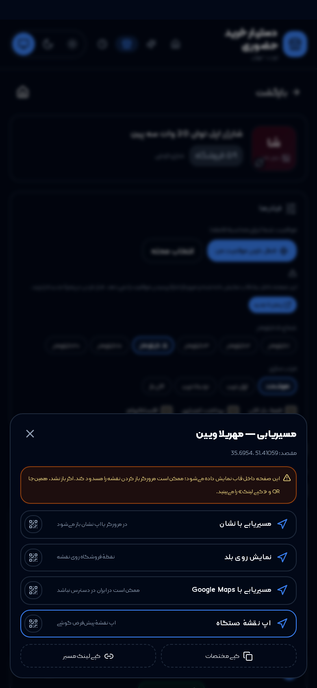 |
| مسیریابی وقتی پنجرهٔ جدید مسدود است (QR) | 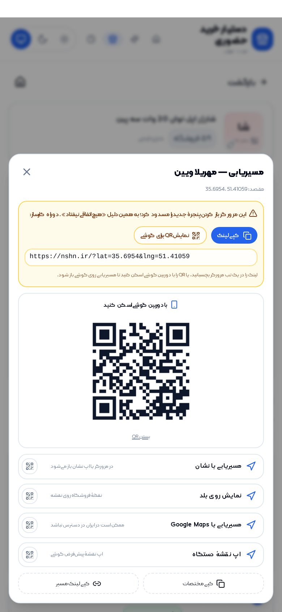 | 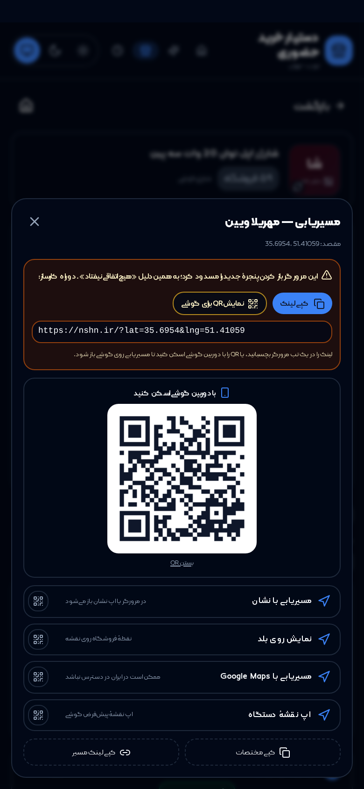 |
| استعلام قیمت و موجودی | 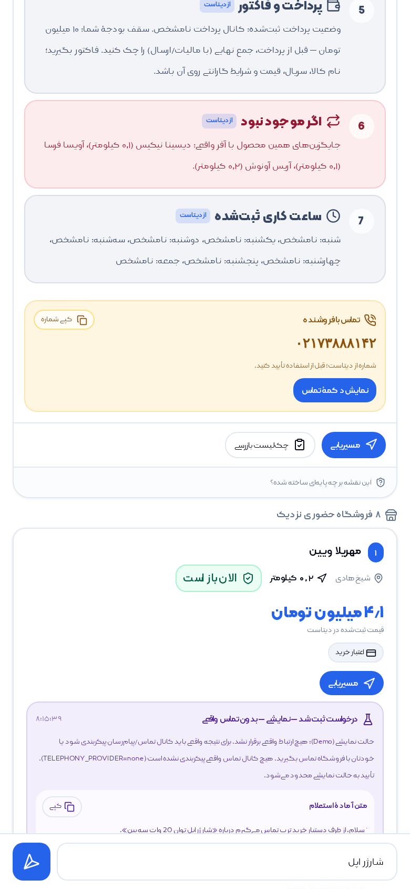 | 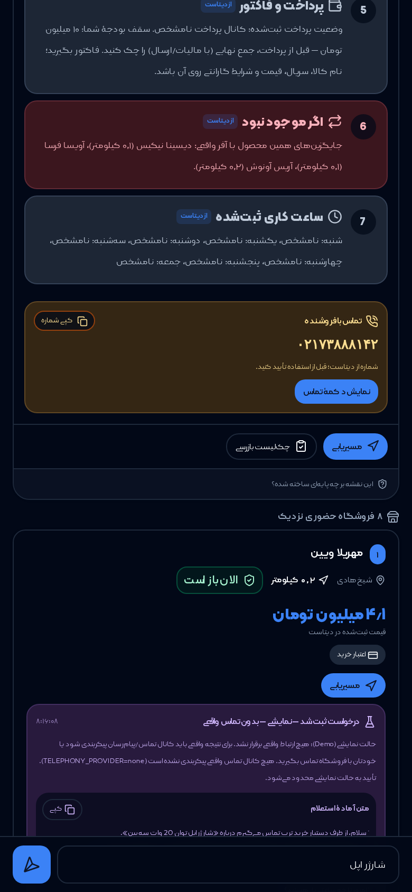 |
| پیگیری استعلام‌ها | 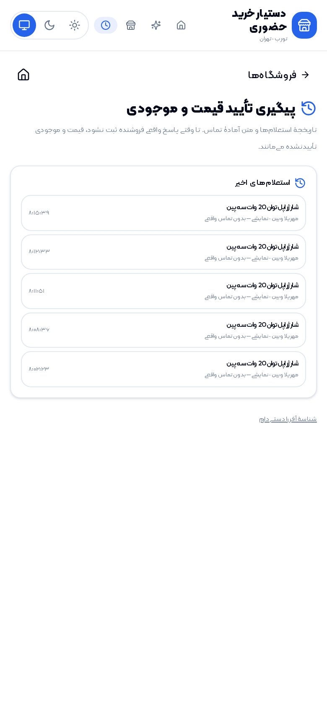 | 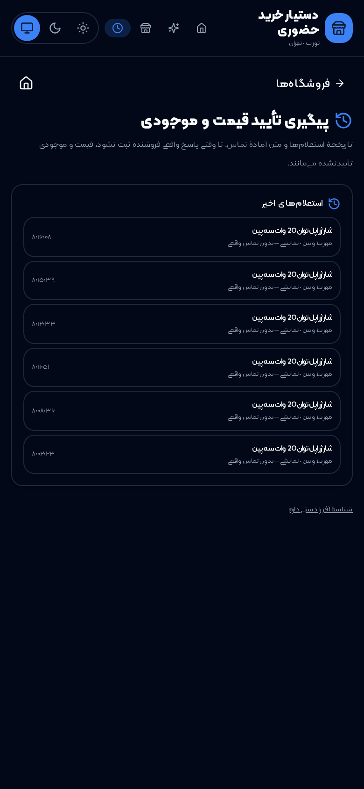 |

هر دو تم از سوییچ هدر (روشن/تاریک/سیستم) در دسترس‌اند و اسکرین‌شات‌ها از اجرای
واقعی با GPS شبیه‌سازی‌شده گرفته شده‌اند (`scripts/tools/shoot.py`).

---

## این پروژه یک ایجنت است، نه نمایش قیمت

ایجنت یک **حلقهٔ tool calling** واقعی دارد: تصمیم می‌گیرد، ابزار صدا می‌زند،
نتیجه را می‌بیند و دوباره تصمیم می‌گیرد — تا وقتی نقشهٔ خرید حضوری آماده شود.

### کدام مدل؟

مدل از `LLM_PROVIDER` انتخاب می‌شود (بدون هیچ کلید هاردکدشده):

| provider | مدل پیش‌فرض | کلید |
|---|---|---|
| `openai` | `gpt-4o-mini` | `LLM_API_KEY` |
| `openrouter` | `openai/gpt-4o-mini` | `LLM_API_KEY` |
| `groq` | `llama-3.3-70b-versatile` | `LLM_API_KEY` |
| `ollama` | `qwen2.5:7b-instruct` | ندارد (محلی) |
| `anthropic` | `claude-3-5-sonnet-latest` | `LLM_API_KEY` |
| `none` (پیش‌فرض) | — | — |

در حالت `none` همان حلقه با **برنامه‌ریز قطعی** (`planner.py`) اجرا می‌شود: ابزارها،
ترتیب تصمیم‌ها و قالب پاسخ یکی است، فقط «تصمیم‌گیرنده» قاعده است نه مدل. این
انتخاب صادقانه است: هیچ کلیدی در مخزن نیست و در دمو ادعای وصل‌بودن به مدل نمی‌کنیم.
پاسخ API فیلد `reasoning_engine` و `model_label` دارد، پس در هر لحظه معلوم است کدام
مسیر اجرا شده. جزئیات: [`docs/agent.md`](docs/agent.md)

### نُه ابزار در اختیار ایجنت

`search_products` · `get_product` · `find_stores` · `compare_offers` ·
`request_verification` · `set_location` · `list_locations` ·
`dataset_coverage` · `build_purchase_guide`

### نقشهٔ خرید حضوری

خرج کار فقط «لیست فروشگاه» نیست؛ ایجنت برای هر درخواست یک نقشهٔ گام‌به‌گام
می‌سازد: تأیید تلفنی → مسیر → چه بپرسید → بازرسی کالا → پرداخت و فاکتور →
اگر موجود نبود چه کنید. هر گام برچسب دارد که از **دیتاست** آمده یا **راهنمای
عمومی** خرید است.

### هر خواسته‌ای، حتی بیرون از دیتاست

اگر کالا در دیتاست نباشد (مثل «بلیط هواپیما»)، ایجنت **هیچ فروشگاه/قیمت
ساختگی نمی‌سازد** ولی کاربر را هم دست‌خالی برنمی‌گرداند: نزدیک‌ترین دسته‌های
دیتاست را پیشنهاد می‌دهد و راهنمای خرید حضوری می‌دهد.

---

## نقاط کلیدی طراحی

### ۱) اتصال واقعی سه‌جدولی، نه داده ساختگی

هر فروشگاهی که نمایش داده می‌شود، از این مسیر آمده است:

```
products.product_id  ←  offers.product_id
offers.shop_id       →  shops.shop_id
```

یعنی «فروشگاه X این محصول را دارد» از یک ردیف واقعی `offers` می‌آید.
تأیید شد که هیچ آفری به فروشگاه/محصول ناموجود اشاره نمی‌کند (۰ خطای FK).

### ۲) رتبه‌بندی شفاف

امتیاز هر فروشگاه با breakdown پنج‌جزئی برمی‌گردد و در UI به‌صورت میله نمایش داده می‌شود:

| جزء | وزن | منبع |
|---|---|---|
| قیمت | ۰٫۳۸ | `offers.price_toman` نسبت به بازه همین نتیجه |
| فاصله | ۰٫۲۴ | Haversine از مختصات واقعی |
| ساعت کاری | ۰٫۱۶ | `shops.weekly_hours` و «الان باز است؟» |
| پرداخت | ۰٫۱۰ | `shops.payment_options` |
| کامل‌بودن داده | ۰٫۱۲ | چند فیلد از فروشگاه پر شده است |

### ۳) صداقت داده در سطح کامپوننت

| چیزی که ممکن است اشتباه فهمیده شود | کاری که ما می‌کنیم |
|---|---|
| «قیمت ۴٫۱ میلیون» | برچسب «قیمت تأییدنشده» + توضیح snapshot بودن |
| «موجود است» | دیتاست موجودی ندارد → همیشه «موجودی نامشخص» |
| «فروشگاه آذروش نویرا» | برچسب «نام تأییدنشده» |
| «تأیید قیمت انجام شد» | اگر کانال واقعی نباشد → «نمایشی — بدون تماس واقعی» |
| «مشخصات: —» | «مشخصات ثبت نشده؛ ما حدس نمی‌زنیم» |

### ۴) تایپوگرافی فارسی، نه فونت پیش‌فرض سیستم

- فونت **کلمه (Kalameh)** در ۶ وزن، به‌صورت **self-hosted** در
  `frontend/public/fonts/kalameh/` — بدون CDN، بدون درخواست خارجی، آفلاین هم درست است.
  حجم کل: ۱۴۶٫۴ کیلوبایت (زیرمجموعه‌سازی WOFF2 با `fontTools`).
- فونت جای‌گزین **Vazirmatn** (مجوز آزاد OFL) هم self-host است تا اگر کلمه نبود،
  فارسی با Tahoma نمایش داده نشود. در مسیر بدون کلمه، کل اپ روی همین فونت کار می‌کند.
- چهار وزن ۴۰۰/۵۰۰/۷۰۰/۸۰۰ پیش‌لود می‌شوند؛ همان وزن‌هایی که کلاس‌های
  `font-medium`/`semibold`/`bold`/`extrabold` استفاده می‌کنند.
- **همه ارقام رابط کاربری فارسی‌اند**: «۶٬۴۷۶ فروشگاه»، «۱٫۸ میلیون تومان»،
  «۰٫۱ کیلومتر»، «امتیاز تطابق: ۰٫۸۵». تبدیل در بک‌اند (`fa_number`) و فرانت‌اند
  (`faDecimal`) انجام می‌شود تا هیچ عددی به‌صورت ۴٫۲ در متن RTL جا نیفتد.
- ارقام داخل **نام محصول** (مثل «مدل J30») عمداً لاتین می‌مانند؛ بخشی از نام رسمی
  محصول‌اند و تبدیل‌شان مدل را تحریف می‌کند.
- ⚠️ **لایسنس:** کلمه فونتی تجاری از fontiran.com است و مجوز توزیع عمومی آن
  تأییدنشده است — برای انتشار تجاری یا مجوز باید خریداری شود یا بلوک‌های
  `@font-face` کلمه حذف شوند تا اپ روی Vazirmatn (OFL) اجرا شود. جزئیات در
  `docs/known-issues.md` بخش ۶.

---

## مرجع سریع API

| متد | مسیر | کار |
|---|---|---|
| GET | `/api/health` | سلامت + شمارش رکوردها |
| GET | `/api/dataset/meta` | شناسنامه دیتاست و هشدارهای شفافیت |
| GET | `/api/dataset/locations` | محله‌های واقعی دیتاست |
| POST | `/api/discover` | گام بعدی کشف نیاز (نشست‌دار) |
| POST | `/api/products/search` | جست‌وجوی محصول |
| GET | `/api/products/{id}` | جزئیات + مشخصات |
| POST | `/api/stores/search` | فروشگاه‌های دارای آفر + رتبه‌بندی |
| POST | `/api/stores/compare` | مقایسه تا ۶ آفر |
| POST | `/api/verify` | درخواست تأیید (Demo/واقعی) |
| GET | `/api/verify/{offer_id}` | تاریخچه تأیید |

مستند تعاملی: `http://localhost:8000/docs`

---

## تست

```bash
make test          # ۱۳۲ تست روی نمونه‌ای از داده واقعی
make smoke         # تست سرتاسری روی دیتابیس کامل
make lint          # بررسی تایپ TypeScript
```
